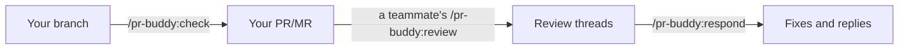

# PR Buddy for Claude Code

**Code review on GitHub and GitLab, without leaving Claude Code.** It reviews, drafts and replies in your voice. Nothing
goes out until you say `send`.

[](https://github.com/andret2344/pr-buddy-for-claude-code/actions/workflows/ci.yml)


[](LICENSE)

[Quick start](#quick-start) · [Commands](#commands) · [Requirements](#requirements) · [Updates](#updates)

## Why pr-buddy

- **You hold the send button.** Nothing is posted until you have seen the full payload and answered with `send` (or
  `wyślij`). Each post is a single batch: one review, one notification.
- **Your repository stays yours.** `review`, `respond` and `check` work on a local clone of the repository. They never
  check out, fetch, pull, commit or push; they hand you those commands.
- **Your rules, your voice.** pr-buddy learns from your past review comments and ships no review rules of its own.
  Where your rules and the repository's disagree, the repository wins.

## Quick start

In a Claude Code session:

```
/plugin marketplace add andret2344/pr-buddy-for-claude-code
/plugin install pr-buddy@andret2344
/pr-buddy:learn
```

Or install from a shell, then run `/pr-buddy:learn` in a session:

```
claude plugin marketplace add andret2344/pr-buddy-for-claude-code
claude plugin install pr-buddy@andret2344
```

`/pr-buddy:learn` runs once, before the first review. After that:

```
/pr-buddy:review <PR/MR link or number>
/pr-buddy:respond <PR/MR link or number>
/pr-buddy:check [PR/MR link or number] [--committed] [--full]
```

## Commands

| Command   | Whose remarks                  | Edits code          | Posts             |
|:----------|:-------------------------------|:--------------------|:------------------|
| `review`  | yours, on someone else's PR/MR | no                  | yes, after `send` |
| `respond` | the reviewers', on your PR/MR  | yes, once you agree | yes, after `send` |
| `check`   | pr-buddy's, on your own code   | no                  | never             |

On your own PR/MR, `respond` handles what the reviewers wrote and `check` catches what they missed.



### `/pr-buddy:review`

Reviews someone else's pull/merge request and posts the review under your name. You keep, edit or drop each comment and
pick the verdict before anything is sent. A feature with no test counts as blocking, unless it cannot be tested or a
test is not worth its setup. When the repository configures a coverage tool, it asks whether to run the tests with
coverage, which runs the author's code on your machine.

### `/pr-buddy:respond`

Works through the review threads on your own pull/merge request: triage, discussion, local edits, then replies.

### `/pr-buddy:check`

Reviews your own branch or pull/merge request and lists the problems in the session and in `.review/` in the clone,
posting nothing.

- It reads the working tree, uncommitted changes included; `--committed` limits it to HEAD.
- Once a report exists, a run reviews only the files changed since the commit the report names; `--full` reviews
  every changed file again. A rebase or a change to your guidelines makes the run full on its own.
- On the default branch with no PR/MR (`main`), it reviews only the uncommitted changes and suggests moving them to a
  branch of their own.
- A feature with no test is blocking, unless it cannot be tested or a test is not worth its setup; those it lets go
  are listed with the reason. In a repository with no tests at all, it suggests adding some instead. When the
  repository configures a coverage tool, it asks whether to run the tests with coverage.
- The report holds the open findings and the features let go without a test, and `check` offers to delete it once the
  PR/MR is merged or closed or the branch is gone. It looks for such leftovers on a full run, or when you ask.
- The points you talk it out of go into `.review/waivers.md`, shared by every branch, and come back when the code they
  rely on changes.
- Git must ignore `.review/`; the first run hands you the command, for bash and for PowerShell, best done once for the
  whole machine.

### `/pr-buddy:learn`

Learns from your past review comments: your voice (`/pr-buddy:learn-voice`) and the rules you keep enforcing
(`/pr-buddy:learn-guidelines`). Run it once before the first review.

## Requirements

- Claude Code 2.1.284 or later (see [Claude Code version](#claude-code-version)).
- At least one platform CLI, logged in: [`gh`](https://cli.github.com/) for GitHub,
  [`glab`](https://gitlab.com/gitlab-org/cli) for GitLab (gitlab.com).
- [`jq`](https://jqlang.org/).
- A POSIX shell (Bash; Git Bash on Windows).

## Claude Code version

pr-buddy is built for Claude Code 2.1.284 or later; on older versions the platform settings show up as a plain text
field instead of a true/false choice. Check yours with `claude --version`; `claude doctor` also shows how it was
installed.

To update, close every Claude Code session first, then run the command for your installation in a regular terminal. None
of them needs administrator rights, except `sudo` for the Linux packages.

<details>
<summary>Update commands</summary>

| Installed with   | Update command                                                |
|:-----------------|:--------------------------------------------------------------|
| Native installer | `claude update`                                               |
| npm              | `npm install -g @anthropic-ai/claude-code@latest` (no `sudo`) |
| Homebrew         | `brew upgrade claude-code` (or `claude-code@latest`)          |
| WinGet           | `winget upgrade Anthropic.ClaudeCode`                         |
| apt              | `sudo apt update && sudo apt upgrade claude-code`             |
| dnf              | `sudo dnf upgrade claude-code`                                |
| apk              | `apk update && apk upgrade claude-code`                       |

</details>

Then start Claude Code again: the new version takes effect only in a new session.

## Platforms

When you enable the plugin, Claude Code asks which platforms pr-buddy may use; both are on by default. Turn one off to
keep pr-buddy away from it even while its CLI is logged in, for example a work account: it will neither learn from nor
post to that platform. You can change the choice later in `/config` or in `/plugin` → Installed → pr-buddy → Configure
options.

## Updates

Claude Code does not auto-update third-party marketplaces by default. Turn it on once, in a Claude Code session:

1. Run `/plugin` and go to **Marketplaces**.
2. Select **andret2344**.
3. Select **Enable auto-update**.

Or set `autoUpdate` in `~/.claude/settings.json`, on the entry that adding the marketplace already wrote there:

```json
"extraKnownMarketplaces": {
  "andret2344": {
    "source": { "source": "github", "repo": "andret2344/pr-buddy-for-claude-code" },
    "autoUpdate": true
  }
}
```

From then on, up to ten minutes after the first message of a session, Claude Code fetches a new version in the background
and asks you to run `/reload-plugins`.

Without auto-update, update by hand:

```
/plugin marketplace update andret2344
```

or, from a shell, `claude plugin update pr-buddy@andret2344`.

## Private files

Kept in `~/.claude/pr-buddy/`, never in this repository:

- `guidelines.md`: your review rules, drafted by `/pr-buddy:learn-guidelines`; the plugin ships none of its own. Reviews
  also follow the rules a repository documents (`CONTRIBUTING.md`, `CLAUDE.md`, `AGENTS.md`, linter configs, coverage
  thresholds), and where the two disagree, the repository's rule wins.
- `voice.md`: a profile of how you write review comments, built by `/pr-buddy:learn-voice`.

## Contributing

See [CONTRIBUTING.md](https://github.com/andret2344/pr-buddy-for-claude-code/blob/main/CONTRIBUTING.md).

## License

[Apache-2.0](LICENSE) © andret2344. Modified versions must keep the [NOTICE](NOTICE) file and mark the files they
change.
